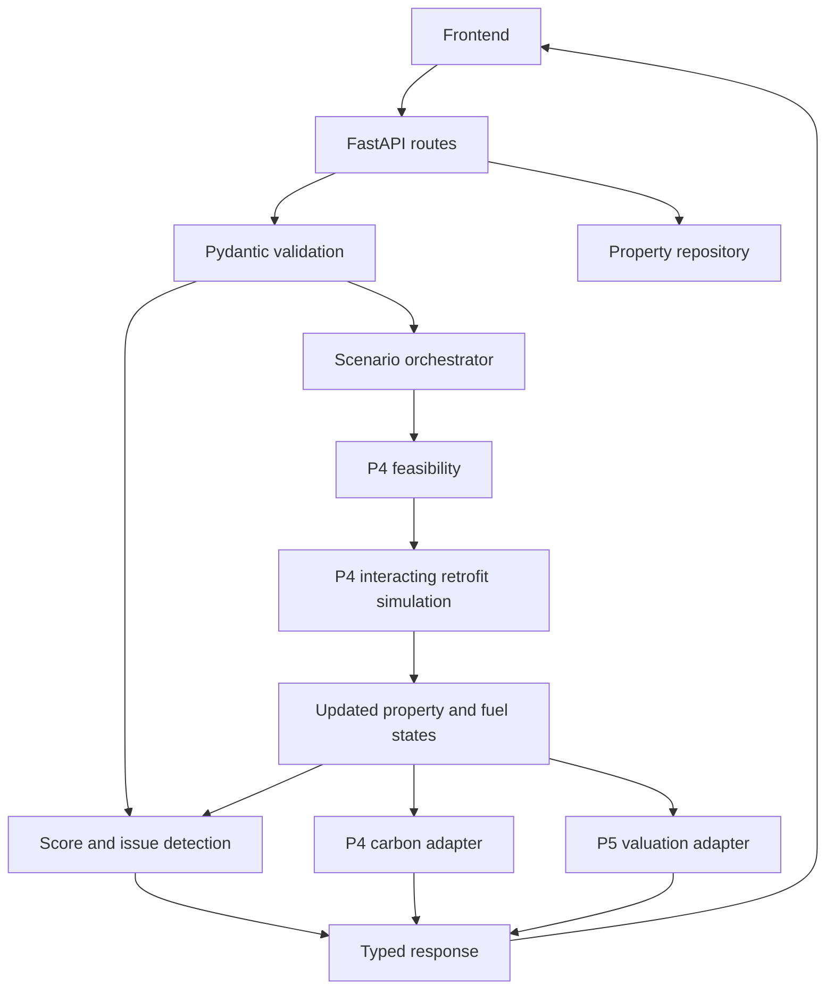

# Backend architecture

FastAPI routes depend on provider functions, enabling test-only adapters and explicit future integrations. Domain scoring remains independent of HTTP and LLM services. Scenario orchestration uses isolated input copies, preserves recorded EPC and fixed property characteristics, derives signed fuel savings, verifies carbon arithmetic, and returns unavailable subresults without manufacturing values.

Current runtime: synthetic JSON property repository, real scoring logic, pending retrofit/carbon adapters, existing P5 valuation adapter. Default scenario cannot run until feasibility/simulation is integrated. Tests inject fixture engines and validate orchestration, not predictive accuracy.

Backend-owned files contain no code comments or docstrings per the user's preference. Existing teammate modules are unchanged.
