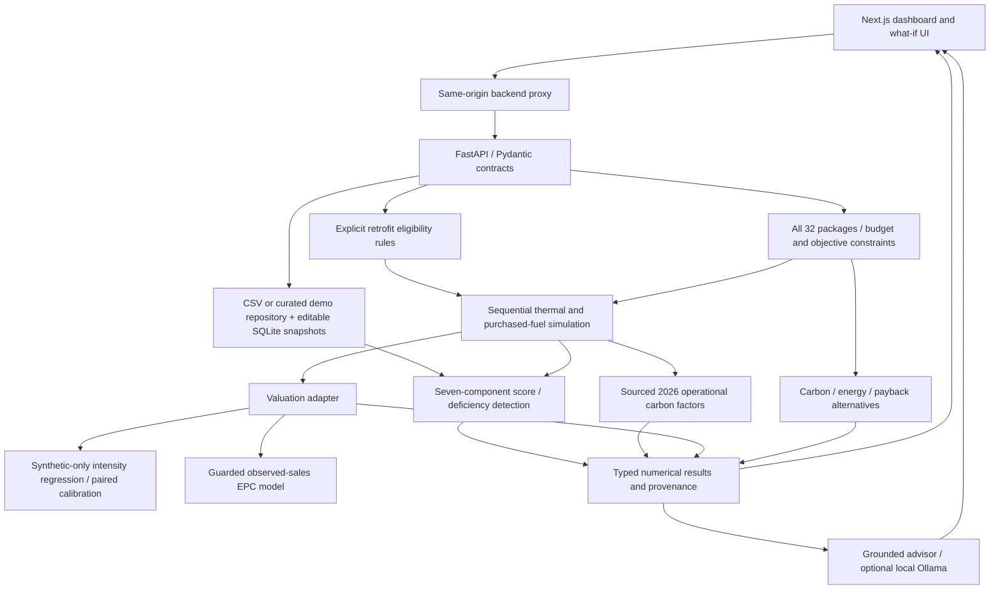

# Current local architecture

The runtime uses the contributed retrofit/carbon engines, production routes and persisted SQLite snapshots. Scoring and simulation operate without an LLM. The advisor calls these same services for fresh what-if results and only selects/explains supplied facts.

Simulation preserves property identity, region, area, age, bedrooms, market context, current value and recorded EPC. It updates physical system state, derives signed per-fuel savings, verifies carbon arithmetic, and propagates missing-data reasons. Conditional/infeasible installations are blocked.

For explicitly synthetic properties **and** synthetic annual energy, the valuation adapter consumes the simulator's before/after purchased-energy intensity. It uses a separately trained, monotonic intensity-based model and paired conformal radius. It anchors the model contrast to the supplied current value and returns `illustrative` with synthetic/coverage warnings. It never changes EPC or supplies a real-market premium. Missing models, critical fields or unsupported features return `unavailable`. Observed/estimated inputs continue through the guarded EPC-sales path; unsupported projected EPC stays unavailable.

The optimiser enumerates all 32 subsets and records eligibility, missing costs, rejected budgets and unavailable objective inputs. Its best scenario includes a structured explanation, comparable alternative winners and the simulation sequence. The frontend preserves backend suitability/priority, distinguishes unranked options, and displays actual financial and energy tradeoffs.

Reproduction and packaging: `scripts/reproduce_submission.py`, `scripts/build_submission.py`, and [submission guide](submission_guide.md). Local models and build/dependency directories are generated artifacts; private SQLite snapshots and environment secrets are excluded from the bundle.
